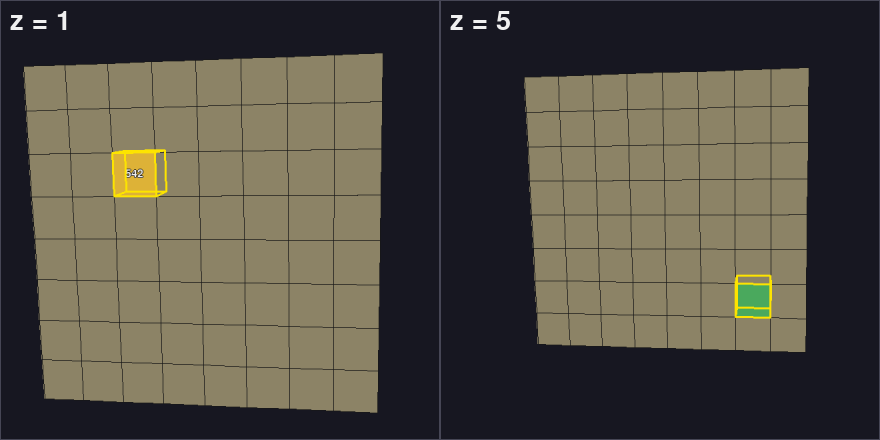
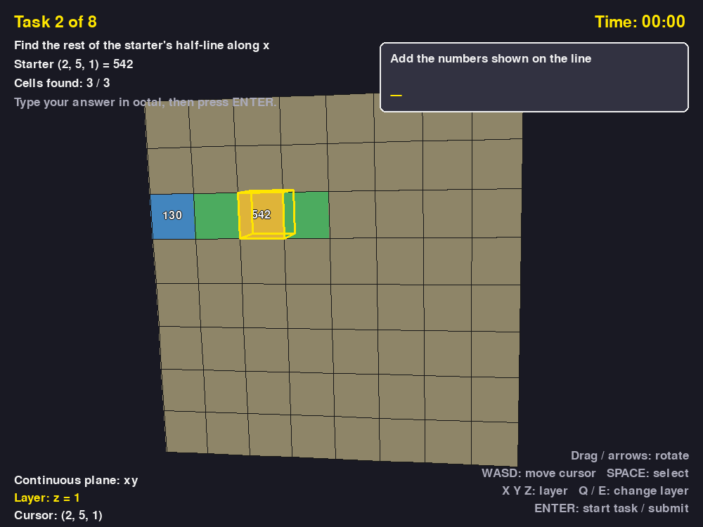
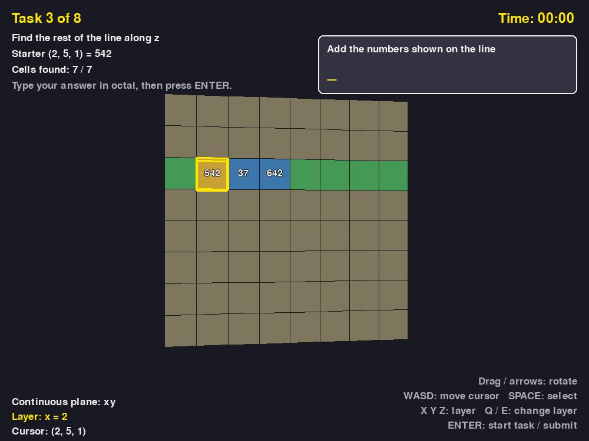
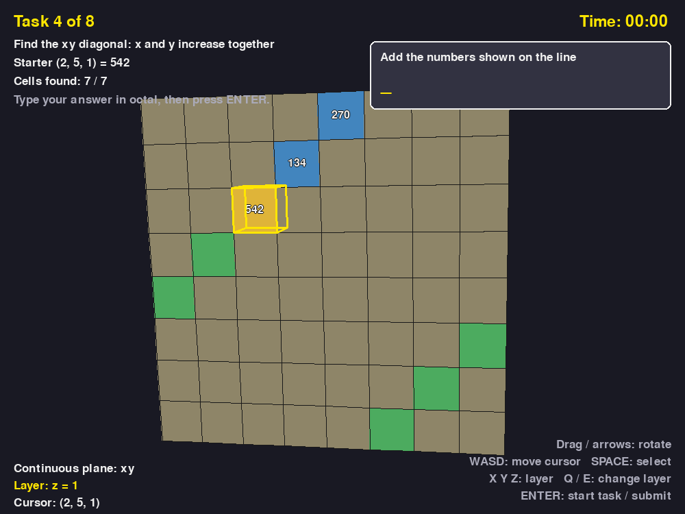
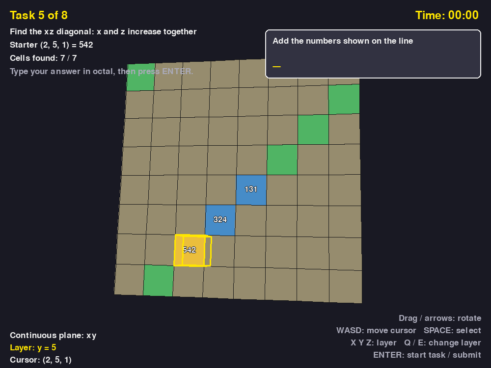
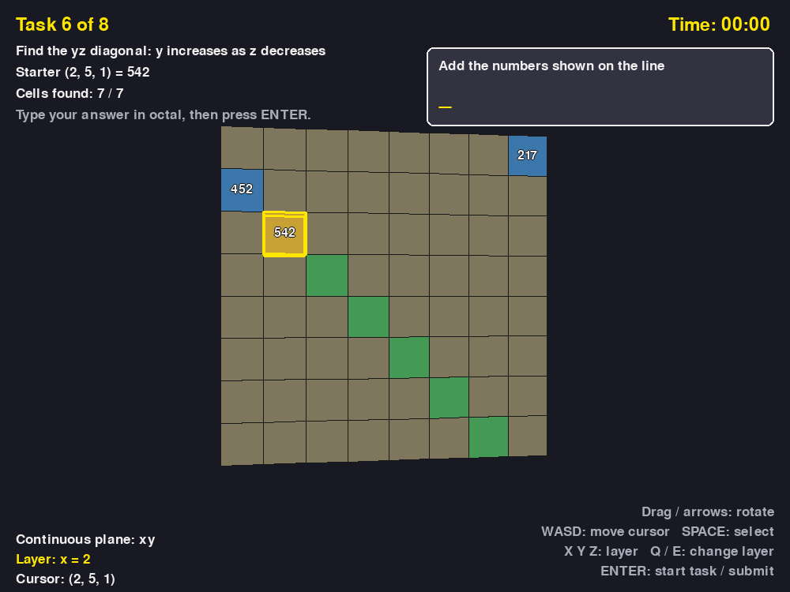
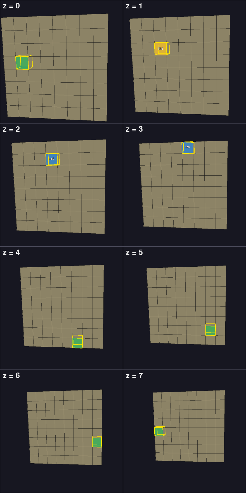
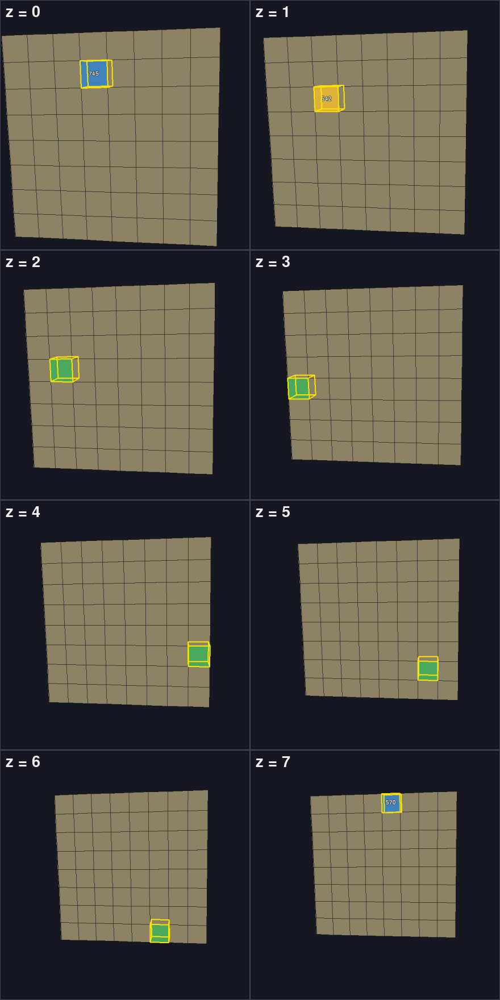

# PoC fixed round: steps and answers

Numbers are in octal, as the game shows them, with decimal in brackets. Cells are written (x, y, z), as the game's "Cursor" readout shows them. x runs left to right, y bottom to top and z front to back, counting from 0.

- Continuous plane: XY
- Starter: (2, 5, 1) = 542 (decimal 354)

Each task: press ENTER to start it, then select the cells (right click or SPACE). After the last cell, type each answer and press ENTER.

Each picture shows the task once every cell is found, from the view that shows the line best. Rotate with a left drag or the arrow keys. Where a task needs several layers, there is one picture per layer, and the outlined cell in each is the one in that layer.

## Task 1: complement

Best view: no single layer holds both cells, so step between layers z = 1 and z = 5 (press Z, then Q/E), looking at each from the front.

Cells to select:

- (6, 1, 5) = 237 (decimal 159)

1. Subtract: 1001 − 542 = **237** (decimal 159)

## Task 2: half orthogonal x

Best view: layer z = 1 on its own (press Z, then Q/E to reach 1), looking at it from the front.

Cells to select:

- (0, 5, 1) = 130 (decimal 88)  ← add this one
- (1, 5, 1) = 233 (decimal 155)
- (3, 5, 1) = 655 (decimal 429)

1. Add: 542 + 130 = **672** (decimal 442)
2. Subtract: 2002 − 672 = **1110** (decimal 584)

## Task 3: orthogonal z (continuous)

Best view: layer x = 2 on its own (press X, then Q/E to reach 2), looking at it from the right-hand side.

Cells to select:

- (2, 5, 2) = 37 (decimal 31)  ← add this one
- (2, 5, 3) = 642 (decimal 418)  ← add this one
- (2, 5, 4) = 737 (decimal 479)
- (2, 5, 5) = 142 (decimal 98)
- (2, 5, 6) = 437 (decimal 287)
- (2, 5, 7) = 242 (decimal 162)
- (2, 5, 0) = 337 (decimal 223)

1. Add: 542 + 37 + 642 = **1443** (decimal 803)
2. Subtract: 4004 − 1443 = **2341** (decimal 1249)

## Task 4: diagonal xy same (split)

Best view: layer z = 1 on its own (press Z, then Q/E to reach 1), looking at it from the front.

Cells to select:

- (3, 6, 1) = 134 (decimal 92)  ← add this one
- (4, 7, 1) = 270 (decimal 184)  ← add this one
- (5, 0, 1) = 676 (decimal 446)
- (6, 1, 1) = 637 (decimal 415)
- (7, 2, 1) = 245 (decimal 165)
- (0, 3, 1) = 111 (decimal 73)
- (1, 4, 1) = 503 (decimal 323)

1. Add: 542 + 134 + 270 = **1166** (decimal 630)
2. Subtract: 4004 − 1166 = **2616** (decimal 1422)

## Task 5: diagonal xz same (split)

Best view: layer y = 5 on its own (press Y, then Q/E to reach 5), looking at it from above.

Cells to select:

- (3, 5, 2) = 324 (decimal 212)  ← add this one
- (4, 5, 3) = 131 (decimal 89)  ← add this one
- (5, 5, 4) = 353 (decimal 235)
- (6, 5, 5) = 257 (decimal 175)
- (7, 5, 6) = 435 (decimal 285)
- (0, 5, 7) = 630 (decimal 408)
- (1, 5, 0) = 446 (decimal 294)

1. Add: 542 + 324 + 131 = **1217** (decimal 655)
2. Subtract: 4004 − 1217 = **2565** (decimal 1397)

## Task 6: diagonal yz diff (split)

Best view: layer x = 2 on its own (press X, then Q/E to reach 2), looking at it from the right-hand side.

Cells to select:

- (2, 6, 0) = 452 (decimal 298)  ← add this one
- (2, 7, 7) = 217 (decimal 143)  ← add this one
- (2, 0, 6) = 367 (decimal 247)
- (2, 1, 5) = 122 (decimal 82)
- (2, 2, 4) = 32 (decimal 26)
- (2, 3, 3) = 677 (decimal 447)
- (2, 4, 2) = 707 (decimal 455)

1. Add: 542 + 452 + 217 = **1433** (decimal 795)
2. Subtract: 4004 − 1433 = **2351** (decimal 1257)

## Task 7: triagonal xyz same (split)

Best view: the line passes through every z layer, one cell in each, so step through the layers with Q/E (after pressing Z), looking at each from the front. One picture per layer:

Cells to select:

- (3, 6, 2) = 445 (decimal 293)  ← add this one
- (4, 7, 3) = 170 (decimal 120)  ← add this one
- (5, 0, 4) = 403 (decimal 259)
- (6, 1, 5) = 237 (decimal 159)
- (7, 2, 6) = 334 (decimal 220)
- (0, 3, 7) = 611 (decimal 393)
- (1, 4, 0) = 376 (decimal 254)

1. Add: 542 + 445 + 170 = **1377** (decimal 767)
2. Subtract: 4004 − 1377 = **2405** (decimal 1285)

## Task 8: triagonal xy same z diff (split)

Best view: the line passes through every z layer, one cell in each, so step through the layers with Q/E (after pressing Z), looking at each from the front. One picture per layer:

Cells to select:

- (3, 6, 0) = 745 (decimal 485)  ← add this one
- (4, 7, 7) = 570 (decimal 376)  ← add this one
- (5, 0, 6) = 703 (decimal 451)
- (6, 1, 5) = 237 (decimal 159)
- (7, 2, 4) = 34 (decimal 28)
- (0, 3, 3) = 211 (decimal 137)
- (1, 4, 2) = 76 (decimal 62)

1. Add: 542 + 745 + 570 = **2277** (decimal 1215)
2. Subtract: 4004 − 2277 = **1505** (decimal 837)
